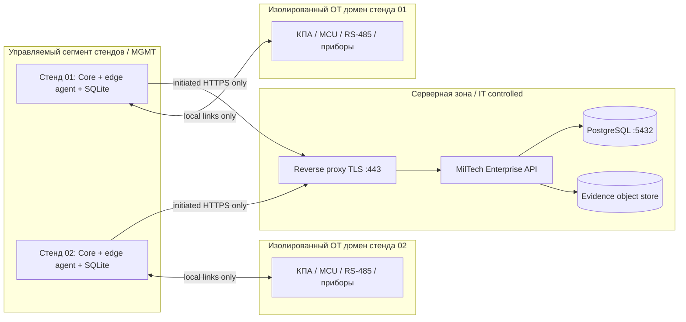

# MilTech Station Enterprise: физическая и логическая топология — Pilot v0.1

Статус: инженерная модель. **IP-адреса/VLAN в примере НЕ являются согласованным адресным планом предприятия.**
Граница: предприятие / MilTech Enterprise / испытательные стенды / КПА. Не переносить из учебной топологии конкретные значения в production без обследования IT/OT.

## Физическая/логическая схема

Принцип: Enterprise не маршрутизирует в OT-сегмент КПА и не вызывает прямые аппаратные команды. Локальный Core — владелец hardware lifecycle. Агент синхронизации не получает привилегии управления оборудованием.

## Сегментация

| Домен | Пример (НЕ производственный адресный план) | Назначение |
|---|---|---|
| MGMT / station | VLAN 130, 10.30.30.0/27 | Исходящие запросы станции к серверу, централизованная диагностика |
| SERVER | 10.30.50.0/27 | HTTPS, БД, архив, мониторинг |
| STAND-01 OT | VLAN 2201, 192.168.10.0/24 | Локальный обмен ПК ↔ КПА стенда 01 |
| STAND-02 OT | VLAN 2202, 192.168.10.0/24 | Локальный обмен ПК ↔ КПА стенда 02 |

Одинаковая подсеть `192.168.10.0/24` может использоваться на **разных физически/L2 изолированных** стендах. Если их объединить на L2 или маршрутизировать без NAT/VRF, будет конфликт адресов. На одном NIC VLAN поддерживается **только при наличии 802.1Q на драйвере/адаптере Windows и конфигурации trunk/port на управляемом коммутаторе**. Два IPv4 на одном NIC сами по себе **не создают изоляцию**.

В простой поставке без корпоративной сети может быть только Core + OT LAN (или USB/COM): сервер недоступен, испытания продолжаются, Outbox сохраняется.

## Межзоновые правила (deny by default)

| Initiator → Destination | Transport | Решение |
|---|---|---|
| Station agent → API gateway | TCP/443 TLS | Разрешить строго по списку адресов/FQDN |
| API → PostgreSQL | TCP/5432 | Только backend в SERVER; не из MGMT/OT |
| API → Object storage | Конфигурируемый внутренний TLS | Только backend; номер не закреплять без продукта |
| Station → DNS/NTP | Утверждённый IT сервис | По необходимости, отдельные ACL |
| Enterprise server → PLC/MCU/KPA | Любой | Запретить |
| OT of stand 01 → OT of stand 02 | Любой | Запретить |
| HMI → TU EXE | Local IPC | Только QLocalSocket/Windows named pipe с ACL |
| OT device → bound NIC/IP/UDP port | Plugin-specific | Разрешить по опубликованному манифесту конкретной поставки |

**443 и 5432 — инфраструктурные рекомендации, не заявленные порты существующих устройств.** Физические UDP/TCP порты КПА нельзя выбирать наугад: это свойства оборудования и plugin manifest, заданы в ТУ/протоколе. Вариант backend TCP/8000 используется только для локального dev запуска `uvicorn`; в production он должен находиться за TLS reverse proxy.

## Стенд: адреса, маршруты, сокеты

1. Для каждой локальной сетевой точки задать `interface_role`, NIC alias или hardware ID, VLAN ID (где применимо), IPv4/prefix, `SkipAsSource`, gateway и default-route policy.
2. OT без default gateway, с запретом маршрутизации в сервер. На Enterprise/MGMT интерфейсе один утверждённый маршрут по умолчанию, если это допустимо IT-политикой предприятия.
3. Станция должна bind UDP/TCP только к указанному локальному IP. `0.0.0.0` для hardware listener не допускается профилем Pilot.
4. Разделить **local listen** (порт ОС, может конфликтовать), **outbound connect** (локальный ephemeral порт выбирает ОС) и **remote destination** (фиксированный порт удалённого прибора). Не «резервировать» outbound 443 локально.
5. Порт закрепляется за процессом только пока у него есть реально открытый сокет: `bind()` и удержание handle. Проверка свободного порта не является резервированием.
6. Внутри Core должен быть единый ResourceBroker, которому плагины объявляют запрашиваемые COM/VISA/USB/socket ресурсы. Для межпроцессного TU EXE — локальный IPC к Core, не параллельный прямой захват оборудования.
7. Состояние исключительных COM/VISA/USB замков — advisory относительно сторонних программ и драйверов. Проверка реального доступа к устройству обязательна перед тестом.
8. В runtime запрещены неутверждённые изменения IP, DHCP, MAC, VLAN, маршрутов, firewall, драйверов и системного времени.

## Разграничение обязанностей

- **IT/OT администратор:** утверждает IPAM, VLAN, ACL, сертификаты, протоколы обслуживания и политику ОС.
- **Установщик/Provisioner (повышенные права, отдельная операция):** применяет согласованную конфигурацию сети и firewall с откатом, проверяет Windows NIC VLAN поддержку. Здесь не реализован.
- **MilTech Core/StationAgent (обычный пользователь/Windows Service с ограничениями):** читает профиль, обследует фактическое окружение, проверяет bind, получает краткоживущие ресурсы и выполняет разрешённые тесты.
- **Enterprise:** хранит ревизии конфигурации, наблюдаемое состояние стенда, результаты, задания; не исполняет shell-команды на стенде.

## Поставка и автономность

- По умолчанию ProgramData (`C:\ProgramData\MilTech\Station\`) хранит `db/`, `config/`, `artifacts/`, `sync/`, `logs/`; `Program Files` — неизменяемая версия EXE.
- Локальная SQLite `runs.db` и текущая `registrar.db` остаются источниками локальных измерений/жизненного цикла. Добавляется отдельная SQLite `sync/outbox.db`, которая переживает обновление ПО.
- Удалять событие можно **только** по утверждённому retention/backup policy после подтверждения Enterprise; Pilot оставляет его в `ACKED`.
- Станции не следует считать ready для отдельного ТУ, если нет обязательных ресурсов/методик. Однако отсутствие Enterprise не должно блокировать **разрешённые автономные** испытания.
- Период автономности, размер артефактов, retention на диске и требования к питанию устанавливаются после расчёта частоты/размера записей; Pilot их не утверждает.

## Контрольные приёмочные случаи топологии

- Отказ WAN/IT: Core продолжает локальные испытания, события накапливаются без потери.
- Восстановление WAN: события уходят строго в порядке sequence, дубликаты подтверждаются без второй записи.
- Два OT-стенда имеют одинаковые локальные IPv4 и работают независимо из-за разных L2 VLAN.
- Неправильный NIC/IP/отсутствующий COM или занятый UDP порт вызывает ошибку **готовности требуемой проверки**, не аварийное перенастроение ОС.
- Обновление станции не перезаписывает локальные БД, логи и site configuration.
- Восстановление сервера из резервной копии не вызывает молчаливого пересоздания уже принятых runs.
