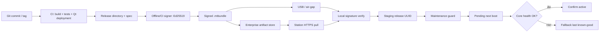

# MilTech Station — поставки и доставка версий / Slice 3

**23.11.2026. Статус: работающий пилотный срез, не промышленное развертывание.**

Поставка — *воспроизводимый и подписанный набор исполняемых компонентов*, а не «переписать EXE и DLL поверх работающей станции». Исходный C++/Qt-код остаётся в системе контроля версий. В Enterprise попадают **собранные** CI-артефакты, декларативные сценарии, каталоги, профили по умолчанию и отдельные ТУ EXE. Исходники в исполнительную среду стенда автоматически не поставляются.

## 1. Границы управления

| Роль | Источник истины и действия |
|---|---|
| CI / Release Engineering | Компиляция C++/Qt и ТУ EXE, тесты, сборка runtime dependencies, SBOM, проверка ABI, подпись release bundle |
| Enterprise Delivery | Хранение неизменяемых бинарных артефактов, каналы `pilot`/`stable`, назначение на станцию, архив состояний |
| Edge DeliveryClient | Исходящее HTTPS 443, получение желаемой версии, локальная проверка подписи, кеширование, подготовка staging |
| Станционный supervisor/Bootstrap | Применение в режиме обслуживания, запуск кандидата, получение health/ready, откат |
| MilTech Core | Завершение испытаний, остановка записи, освобождение приборов, разрешение на обслуживание, проверка работоспособности после перезапуска |
| IT/OT администратор | Windows, драйверы, VLAN/IP/firewall, сертификаты, права и адресное пространство |

**Не реализовано:** фактическое обслуживание Windows Service, остановка Core, IFW-бинарный installer, проверка работающей станции после перезапуска и миграции существующих БД. Команды activation в пилоте требуют флага ручного подтверждения; он не является доказательством отсутствия активного испытания.

## 2. Модель доставки



Для одной станции сервер задаёт `release_id`, `channel` и монотонно возрастающую `target_revision`. Можно назначить тот же подписанный выпуск сначала нескольким пилотным стендам, затем стабильной группе: переподпись и пересборка бинарного содержимого не нужны.

`delivery.releases` хранит UUID, версию, SHA-256, размер, подписанный manifest и подпись. Файлы — в отдельном локальном artifact store по SHA-256 (`blobs/aa/<sha256>.mtbundle`). PostgreSQL не предназначен для хранения EXE в `bytea`.

`delivery.station_targets` хранит актуальное назначение, `delivery.target_history` — последовательность предыдущих назначений. `delivery.station_reports` — наблюдаемые сообщения станции (они не подтверждают нормативную готовность изделия).

## 3. Структура release

`.mtbundle` — ZIP без каталогов/симлинков внутри:

```text
manifest.json                # подписываемый канонический JSON
signature.json               # Ed25519 подпись manifest
payload/application/...      # Station.exe, HMI runtime
payload/plugins/...          # библиотеки конкретных поставок
payload/tu/<method>/...      # отдельные ограниченные ТУ EXE
payload/scenarios/...        # исполняемые сценарии
payload/catalog/...          # нормативные справочники / seed (readonly)
payload/profiles/defaults/...# версии шаблонов профилей
payload/runtime/...          # собственные разрешённые vendor runtime
```

Manifest включает `release_id`, `version`, `target_platform`, `publisher_key_id`, `required_capabilities` и явный список `components[]` с типом, версией, файлами, SHA-256 и размерами. Нет `postinstall.sh`, `.bat` или иных скриптов, которые исполняются автоматически. Не принимаются дополнительные файлы, относительные переходы `..`, Windows special paths, case-insensitive collisions, ZIP symlinks, ZIP-bombs выше установленных лимитов. На станции содержимое проверяется повторно после staging.

Текущий bundle является **полным срезом runtime релиза**, а не delta-патчем отдельных DLL в загруженном процессе. Первая версия специально не допускает «горячего» обновления плагина во время испытания.

## 4. Разделение версий программы и данных

```text
C:\Program Files\MilTech\Station\
  StationBootstrap.exe             # будущий независимый bootstrap (не реализован)
  releases\
    <release_id_1>\
      .manifest.json
      .signature.json
      application\...
      plugins\...
      tu\...
      scenarios\...
      catalog\...
    <release_id_2>\...

C:\ProgramData\MilTech\Station\
  delivery\
    state.json                     # active / previous / pending / boot_attempted
    cache\<sha256>.mtbundle       # подтверждённая offline/online копия
    reports.sqlite3               # очередь подтверждений для Enterprise
  config\                          # настройки места установки (не входят в bundle)
  db\                              # runs.db, parameters.db, ktma/registrar.db, station.db
  sync\outbox.db                   # очередь испытаний
  logs\
  reports\
  backups\
```

**Никакая операция этого пилотного updater не пишет в `db/`, `config/`, `sync/`, `logs/`, `reports/`.** Профили по умолчанию и версии сценариев в release неизменяемые; применение site overrides происходит отдельно через валидируемые управляющие процедуры.

## 5. Обновление и откат

Состояния: `STAGED` → `PENDING_REBOOT` → `ACTIVE`; при отсутствии подтверждения нового запуска — fallback к прежнему `active`; ручной rollback также требует обслуживания. `state.json` перезаписывается только атомарным `os.replace` и синхронизируется на диск, где ОС позволяет.

Последовательность пилотного интерфейса:

1. `stage` — проверка подписи, OS/platform, объявленных capabilities, распаковка в скрытый временный каталог и атомарное перемещение в `releases/<uuid>`. Работающее приложение не трогается.
2. `activate` — только при явном подтверждении обслуживания. Устанавливает `pending`, но **не** меняет `active`.
3. Внешний supervisor запускает `resolve-boot`: выдаётся путь кандидата и ставится флаг `pending_boot_attempted`.
4. После полного self-test Core/supervisor вызывает `confirm-boot`, чтобы сделать кандидат текущим `active`.
5. Если bootstrap перезапущен, а подтверждение не получено, следующий `resolve-boot` снимает `pending` и возвращает прошлый `active`.

Это **модель протокола**, а не уже внедрённая Windows-служба: фактическая остановка, запуск, отслеживание heartbeat и блокировка запуска при активном `RunStore` пока отсутствуют.

## 6. Офлайн-поставка

Один и тот же подписанный файл доставляется через HTTPS либо переносится на USB. Для офлайн-режима нужно **предварительно установить доверенный публичный ключ** издателя и совместимый Bootstrap. USB носитель не становится источником доверия; все файлы проверяются по подписанному manifest. Профили/сертификаты/учётные записи станции не подхватываются из пакета как готовое состояние оборудования.

Подключение Enterprise позже не требует переустановки локальных `runs.db` и результатов. Статусы обновления могут храниться в `delivery/reports.sqlite3` и повторно отправляться после восстановления связи.

## 7. Протокол HTTP (пилот)

| Метод | Endpoint | Доступ / смысл |
|---|---|---|
| POST | `/api/v1/admin/delivery/releases` | Admin, `application/octet-stream` подписанного `.mtbundle` (до 512 МиБ) |
| PUT | `/api/v1/admin/delivery/stations/{id}/target` | Admin, назначить `release_id` и `channel` |
| GET | `/api/v1/stations/me/delivery/desired` | Bearer стенда, текущая целевая версия |
| GET | `/api/v1/stations/me/delivery/bundles/{release_id}` | Bearer стенда, скачать назначенный архив |
| POST | `/api/v1/stations/me/delivery/reports` | Bearer стенда, зарегистрировать `STAGED/PENDING_REBOOT/ACTIVE/FAILED/ROLLED_BACK` |
| GET | `/api/v1/admin/delivery/stations/{id}/reports` | Admin, история сообщений |

В существующий API добавлены маршруты без изменения URL загрузки фактических `RUN_COMPLETED`. Исходящий канал со стенда требует HTTPS, кроме loopback-пилота. Сервер не открывает соединение к физическому OT-интерфейсу стенда.

## 8. CI/CD: последовательность промышленного релиза (проектный план)

```text
checkout/tag
→ configure CMake / Qt / MSVC
→ static analysis + unit + integration tests
→ сборка TU EXE и ABI-проверка
→ deploy Qt dependencies в чистый staging
→ проверка лицензий и допустимости vendor runtime
→ smoke на чистой Windows VM
→ SBOM + build-info (commit SHA, compiler, Qt version, schema compatibility)
→ Windows Authenticode binaries
→ SIGN .mtbundle из защищённого CI/HSM
→ artifact upload Enterprise
→ выборочные pilot назначение и rollback тест
→ stable promotion той же SHA-сборки
```

Qt Installer Framework предлагается для установки и обновления Bootstrap / MaintenanceTool и необходимых машинных компонентов. Само приложение и плагины доставляются независимым механизмом versioned releases. Для vendor drivers, kernel components, BIOS/firmware, C++ runtime Redistributable и системных настроек необходима **отдельная привилегированная поставка** с подтверждённым окном обслуживания и возможностью отката по инструкциям производителя; этот пакет их не запускает.

## 9. Пока не закрыто

- Нет живого Windows Qt Core/RunStore/ResourceBroker/Bootstraper integration.
- Нет аппаратного self-test и реальной maintenance guard, блокирующей активные испытания.
- Нет промышленного TLS/mTLS/SSO/RBAC или горизонтально масштабируемого Artifact Store; pilot использует старый admin-key и station bearer.
- Нет реально испытанного PostgreSQL 16 и Qt Installer Framework setup.
- Нет гарантированного контроля времени на отключённой станции, отзыва подписанного пакета вне сети, аппаратного HSM и Windows Authenticode.
- Нет модели поштучного compatibility across plugin ABI, MCU firmware и состояния аппаратных драйверов; в v1 `required_capabilities` — лишь базовая декларативная проверка.
- Нет возможности обновлять отдельную ТУ EXE независимо от полного release без выпуска нового полного набора.
- Нет автоматического GC/retention артефактов и квот, CDN/resume/range download (пилот скачивает целиком).
